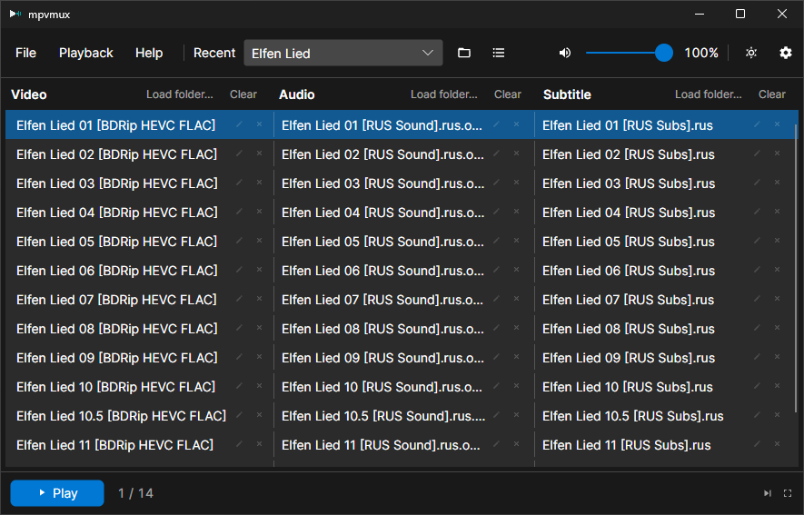

# mpvmux

**A lightweight desktop companion for [mpv](https://mpv.io/) that lets you pair video files with external audio tracks and subtitles - and play them as a queue.**



## Features

- **Track pairing** - three aligned columns for video, audio and subtitles, matched by row order.
- **Queue playback** - the selected row plays in mpv; *Auto Play* advances when playback ends.
- **Bundles** - save a track list as an `.mpvm` file and reopen it from *Recent*.
- **Recent bundles** - pin, reorder, rename, search, remove and re-link missing entries.
- **Backups** - every bundle keeps its previous version for restore.
- **Playback controls** - volume, mute, fullscreen, Stop and remappable shortcuts.
- **Setup** - mpv detection, plus a tray menu for autoplay, fullscreen and exit.
- **Update check** - manual or at startup, against the latest GitHub release.

## Requirements

- **mpv** installed - either on your `PATH` or pointed to in *File → Preferences*.
- **Windows 10 or newer** for the packaged build; the **.NET 10 SDK** to build from source.
- Windows is the primary platform. mpvmux is built with [Avalonia](https://avaloniaui.net/), so the source also runs on Linux (self-contained `linux-x64` builds are published) and macOS, where tray and menu behaviour differ.

## Installation

### Windows

1. Download the latest release from the [Releases page](https://github.com/regularentropy/mpvmux/releases/latest) and unzip it anywhere.
2. Run `mpvmux.exe` - the build is self-contained, so no separate .NET installation is needed. If `mpv` is not on your `PATH`, set its location under *File → Preferences*.

### From source

```bash
git clone https://github.com/regularentropy/mpvmux.git
cd mpvmux
dotnet run --project src/mpvmux/mpvmux.csproj
```

To produce a self-contained single-file build:

```bash
dotnet publish src/mpvmux/mpvmux.csproj -c Release -r win-x64 --self-contained true -p:PublishSingleFile=true -o publish/win-x64
dotnet publish src/mpvmux/mpvmux.csproj -c Release -r linux-x64 --self-contained true -p:PublishSingleFile=true -o publish/linux-x64
```

## Usage

1. **Add videos** - drop files or a folder onto the **Video** column, or click *Load folder*. Videos define the rows.
2. **Add audio and subtitles** the same way. Files are matched to videos **by row order**, so keep the lists sorted the way you want them played; a row without a video is shown but cannot be played.
3. **Adjust and play** - select a row, replace cells or remove rows, set the volume and press **Play**. mpv opens with the selected video and its external tracks attached.
4. **Save your work** - *File → Save* (<kbd>Ctrl</kbd>+<kbd>S</kbd>) writes an `.mpvm` bundle, which appears in the *Recent* dropdown for quick switching.

## Keyboard shortcuts

Defaults are listed below; every shortcut except <kbd>Alt</kbd>+<kbd>F4</kbd> can be changed under *File → Preferences → Keyboard shortcuts* - click **Change**, press the new combination and save. Backspace resets the highlighted action, **Reset all shortcuts** restores every default, and a shortcut needs <kbd>Ctrl</kbd> or <kbd>Alt</kbd> unless it uses a function key.

Shortcuts only work while mpvmux has focus unless **Global** is ticked for that action in Preferences, which handles it system-wide even when mpvmux is minimized or mpv is in front; scope is per action, so keep editing shortcuts local. Global shortcuts use the system hook ([SharpHook](https://github.com/TolikPylypchuk/SharpHook)): on Windows and macOS matching keys are swallowed and only mpvmux reacts (macOS asks for Accessibility permission on first use), on Linux X11 the key also reaches the focused application, and on Wayland hooks need elevated privileges and may not work at all.

| Shortcut | Action |
| --- | --- |
| <kbd>Ctrl</kbd>+<kbd>N</kbd> | New bundle |
| <kbd>Ctrl</kbd>+<kbd>O</kbd> | Open bundle |
| <kbd>Ctrl</kbd>+<kbd>S</kbd> | Save bundle |
| <kbd>Ctrl</kbd>+<kbd>Shift</kbd>+<kbd>S</kbd> | Save bundle as… |
| <kbd>Ctrl</kbd>+<kbd>Enter</kbd> | Play selected video |
| <kbd>Ctrl</kbd>+<kbd>P</kbd> | Pause / resume playback |
| <kbd>Ctrl</kbd>+<kbd>Shift</kbd>+<kbd>Enter</kbd> | Stop playback |
| <kbd>Ctrl</kbd>+<kbd>Left</kbd> | Previous track |
| <kbd>Ctrl</kbd>+<kbd>Right</kbd> | Next track |
| <kbd>Ctrl</kbd>+<kbd>Shift</kbd>+<kbd>A</kbd> | Toggle autoplay |
| <kbd>Ctrl</kbd>+<kbd>Shift</kbd>+<kbd>F</kbd> | Toggle start-in-fullscreen |
| <kbd>F5</kbd> | Check for updates |
| <kbd>F1</kbd> | About mpvmux |

## Contributing

Issues and pull requests are welcome on [GitHub](https://github.com/regularentropy/mpvmux). If you are reporting a playback problem, include your mpv version, OS, and the track configuration that triggered it.

## License

[GPLv3](LICENSE) © 2025 [regularentropy](https://github.com/regularentropy)
