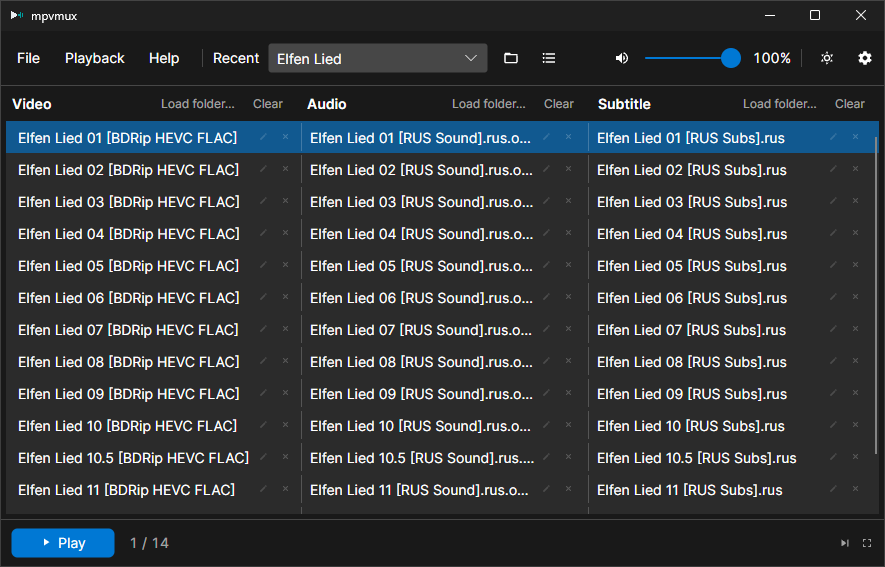

# mpvmux
[](https://github.com/regularentropy/mpvmux/actions/workflows/build-self-contained.yml)
[](https://github.com/regularentropy/mpvmux/releases)
[]()
[](https://www.gnu.org/licenses/gpl-3.0)

**A lightweight desktop companion for [mpv](https://mpv.io/) that lets you pair video files with external audio tracks and subtitles - and play them as a queue.**



## Features

- **Track pairing** - video, audio and subtitles matched by row order.
- **Drag & drop** - drop files or a folder onto any column.
- **Queue playback** - play the selected row in mpv.
- **Autoplay** - advance to the next row when playback ends.
- **Bundles** - save the track list as an `.mpvm` file.
- **Missing media** - flag renamed or moved files and relink in one click.
- **Backups** - restore the previous version of a bundle.
- **Autosave** - write the open bundle shortly after each edit.
- **Single instance** - a second launch opens in the already running window.
- **Playback controls** - volume, mute, fullscreen and Stop.
- **Shortcuts** - remappable, optionally global.
- **Setup** - detect mpv and expose a tray menu.
- **Update check** - manual or at startup.

## Requirements

- **mpv** installed - either on your `PATH` or pointed to in *File → Preferences*.
- **Windows 10 or newer** for the packaged build; the **.NET 10 SDK** to build from source.
- Windows is the primary platform. mpvmux is built with [Avalonia](https://avaloniaui.net/), so the source also runs on Linux (self-contained `linux-x64` builds are published) and macOS, where tray and menu behaviour differ.

## Installation

### Windows

1. Download the latest release from the [Releases page](https://github.com/regularentropy/mpvmux/releases/latest) and unzip it anywhere.
2. Run `mpvmux.exe` - the build is self-contained, so no separate .NET installation is needed. If `mpv` is not on your `PATH`, set its location under *File → Preferences*.

### From source

```bash
git clone https://github.com/regularentropy/mpvmux.git
cd mpvmux
dotnet run --project src/mpvmux/mpvmux.csproj
```

To produce a self-contained single-file build:

```bash
dotnet publish src/mpvmux/mpvmux.csproj -c Release -r win-x64 --self-contained true -p:PublishSingleFile=true -p:IncludeNativeLibrariesForSelfExtract=true -o publish/win-x64
dotnet publish src/mpvmux/mpvmux.csproj -c Release -r linux-x64 --self-contained true -p:PublishSingleFile=true -p:IncludeNativeLibrariesForSelfExtract=true -o publish/linux-x64
```

Both commands produce a single executable. Native libraries are embedded in it and extracted to a
temporary folder on startup.

## Usage

1. **Add videos** - drop files or a folder onto the **Video** column, or click *Load folder*. Videos define the rows.
2. **Add audio and subtitles** the same way. Files are matched to videos **by row order**, so keep the lists sorted the way you want them played; a row without a video is shown but cannot be played.
3. **Adjust and play** - select a row, replace cells or remove rows, set the volume and press **Play**. mpv opens with the selected video and its external tracks attached.
4. **Save your work** - *File → Save* (<kbd>Ctrl</kbd>+<kbd>S</kbd>) writes an `.mpvm` bundle.

## Keyboard shortcuts

Defaults are listed below; every shortcut except <kbd>Alt</kbd>+<kbd>F4</kbd> can be changed under *File → Preferences → Keyboard shortcuts*.

Shortcuts work only while mpvmux has focus unless **Global** is ticked for the action. Global shortcuts use a system hook ([SharpHook](https://github.com/TolikPylypchuk/SharpHook)); on Wayland they may not work, and macOS asks for Accessibility permission on first use.

| Shortcut | Action |
| --- | --- |
| <kbd>Ctrl</kbd>+<kbd>N</kbd> | New bundle |
| <kbd>Ctrl</kbd>+<kbd>O</kbd> | Open bundle |
| <kbd>Ctrl</kbd>+<kbd>S</kbd> | Save bundle |
| <kbd>Ctrl</kbd>+<kbd>Shift</kbd>+<kbd>S</kbd> | Save bundle as… |
| <kbd>Ctrl</kbd>+<kbd>Enter</kbd> | Play selected video |
| <kbd>Ctrl</kbd>+<kbd>P</kbd> | Pause / resume playback |
| <kbd>Ctrl</kbd>+<kbd>Shift</kbd>+<kbd>Enter</kbd> | Stop playback |
| <kbd>Ctrl</kbd>+<kbd>Left</kbd> | Previous track |
| <kbd>Ctrl</kbd>+<kbd>Right</kbd> | Next track |
| <kbd>Ctrl</kbd>+<kbd>Shift</kbd>+<kbd>A</kbd> | Toggle autoplay |
| <kbd>Ctrl</kbd>+<kbd>Shift</kbd>+<kbd>F</kbd> | Toggle start-in-fullscreen |
| <kbd>F5</kbd> | Check for updates |
| <kbd>F1</kbd> | About mpvmux |

## Contributing

Issues and pull requests are welcome on [GitHub](https://github.com/regularentropy/mpvmux). If you are reporting a playback problem, include your mpv version, OS, and the track configuration that triggered it.

## License

[GPLv3](LICENSE) © 2025 [regularentropy](https://github.com/regularentropy)
